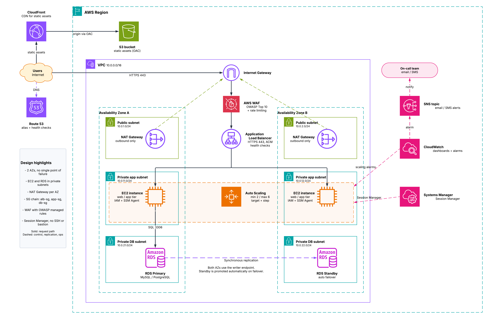
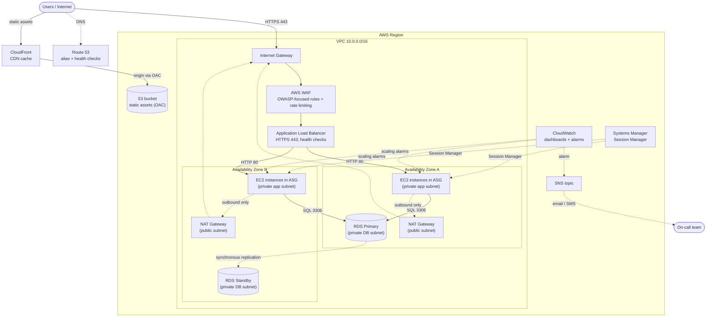

# Scalable Web Application with ALB and Auto Scaling (EC2-Based)

A production-grade, highly available web application on AWS. EC2 instances run in **private subnets across two Availability Zones**, fronted by an **Application Load Balancer protected by AWS WAF**, scaled by an **Auto Scaling Group**, backed by a **Multi-AZ RDS** database, and accelerated by **CloudFront** for static assets. Operations are bastion-free through **Systems Manager Session Manager**, and monitored with **CloudWatch + SNS**.

**[Architecture](#architecture-diagram)** | **[Deployment Guide](#deployment-guide)** | **[Testing](#testing-and-validation)** | **[Report a Bug](../../issues/new?template=bug_report.md)** | **[Ask a Question](../../issues/new?template=question.md)**

> **Note:** This repository documents the design and a manual (console and CLI) deployment procedure. The sample web page does not query the database; the data tier is provisioned and reachable for an application to use.

---

## Table of Contents

1. [Solution Overview](#solution-overview)
2. [Architecture Diagram](#architecture-diagram)
3. [Request Flow](#request-flow)
4. [AWS Services Used](#aws-services-used)
5. [Network Design](#network-design)
6. [Security Design](#security-design)
7. [Deployment Guide](#deployment-guide)
8. [Auto Scaling Configuration](#auto-scaling-configuration)
9. [Monitoring and Alerting](#monitoring-and-alerting)
10. [Testing and Validation](#testing-and-validation)
11. [Cost Considerations](#cost-considerations)
12. [Cleanup](#cleanup)
13. [Troubleshooting](#troubleshooting)
14. [Learning Outcomes Mapping](#learning-outcomes-mapping)
15. [Repository Structure](#repository-structure)
16. [License](#license)

---

## Solution Overview

| Goal | How it is achieved |
|------|--------------------|
| High availability | Two AZs, ALB nodes in both, ASG spanning both, RDS Multi-AZ with automatic failover |
| Scalability | ASG with target tracking and step scaling policies |
| Security | All compute and data in private subnets, WAF with OWASP managed rules, layered NACLs and Security Groups, no SSH or bastion host |
| Performance | CloudFront caches static assets at the edge and reduces origin load |
| Operability | Session Manager access, CloudWatch dashboards and alarms, SNS notifications |

---

## Architecture Diagram



*Solid lines show request traffic. Dashed lines show DNS, replication, egress, and operational paths. The diagram was authored in Lucidchart. It is simplified: AWS WAF is a Web ACL associated with the ALB (not a separate network hop), the ALB has nodes in both public subnets, instances in both AZs connect to the RDS writer endpoint, and outbound instance traffic goes through the NAT Gateway in the same AZ.*

<details>
<summary><b>Text-based version (Mermaid, renders natively on GitHub)</b></summary>



</details>

### Design highlights

* Two Availability Zones with no single point of failure
* Application Load Balancer nodes and NAT Gateways in public subnets, EC2 and RDS in private subnets
* One NAT Gateway per AZ so outbound access survives an AZ failure
* Security Group chain: `alb-sg` to `app-sg` to `db-sg`
* WAF with AWS managed rule groups and a rate-based rule
* Session Manager access with no SSH and no bastion host

---

## Request Flow

1. A user resolves `app.example.com` through **Route 53**. An alias record points to the ALB, and a health check monitors the `/health` endpoint.
2. Dynamic requests reach the **Internet Gateway**, then pass through **AWS WAF** (managed rules for common OWASP Top 10 risks, plus rate limiting) attached to the **ALB**.
3. The ALB terminates TLS (ACM certificate) and forwards HTTP traffic to healthy targets in the **target group**. Targets are EC2 instances in the **private app subnets** of both AZs.
4. EC2 instances connect to the **RDS primary** in the private DB subnets. RDS synchronously replicates to the standby in the other AZ.
5. Static assets (`static.example.com`) are served by **CloudFront** from an **S3 bucket** through Origin Access Control (OAC), so the bucket stays private.
6. Instances reach the internet for patches and package installs through a **NAT Gateway** in the public subnet of the same AZ.
7. Administrators open shell sessions through **Systems Manager Session Manager** over HTTPS, with no inbound ports open.
8. **CloudWatch** collects metrics and evaluates alarms. Alarms publish to an **SNS** topic that notifies the operations team.

---

## AWS Services Used

| Service | Role in the solution |
|---------|----------------------|
| **Amazon VPC** | Isolated network with public, private app, and private DB subnets in two AZs, route tables, NAT Gateways, Security Groups, NACLs |
| **Amazon EC2 + Launch Template** | Web/application servers built from a versioned template |
| **EC2 Auto Scaling** | Maintains capacity, replaces unhealthy instances, scales on demand |
| **Elastic Load Balancing (ALB)** | Layer 7 routing, TLS termination, health checks |
| **AWS WAF** | Web ACL with managed rule groups for common OWASP Top 10 risks |
| **Amazon CloudFront** | CDN for static assets |
| **Amazon S3** | Origin for static assets |
| **Amazon RDS (Multi-AZ)** | MySQL or PostgreSQL with automated failover and backups |
| **Amazon Route 53** | Alias records and health checks |
| **AWS Systems Manager** | Session Manager for bastion-free access |
| **Amazon CloudWatch** | Dashboards, metrics, alarms |
| **Amazon SNS** | Alarm notifications |
| **AWS Certificate Manager** | TLS certificates (ALB in the app region, CloudFront in `us-east-1`) |
| **AWS Secrets Manager** | Database credentials |

---

## Network Design

**VPC CIDR:** `10.0.0.0/16`

| Subnet | AZ | CIDR | Contains |
|--------|----|------|----------|
| public-a | A | `10.0.1.0/24` | ALB node, NAT Gateway |
| public-b | B | `10.0.2.0/24` | ALB node, NAT Gateway |
| private-app-a | A | `10.0.11.0/24` | EC2 instances (ASG) |
| private-app-b | B | `10.0.12.0/24` | EC2 instances (ASG) |
| private-db-a | A | `10.0.21.0/24` | RDS primary or standby |
| private-db-b | B | `10.0.22.0/24` | RDS primary or standby |

### Route Tables

| Route table | Associated subnets | Routes |
|-------------|--------------------|--------|
| `rtb-public` | public-a, public-b | `10.0.0.0/16` local, `0.0.0.0/0` to Internet Gateway |
| `rtb-private-a` | private-app-a | `10.0.0.0/16` local, `0.0.0.0/0` to NAT-A |
| `rtb-private-b` | private-app-b | `10.0.0.0/16` local, `0.0.0.0/0` to NAT-B |
| `rtb-db` | private-db-a, private-db-b | `10.0.0.0/16` local only (no internet route) |

One NAT Gateway per AZ avoids a cross-AZ dependency and keeps outbound access alive if an AZ fails.

---

## Security Design

Defense in depth: **WAF, then NACL, then Security Group, then private subnet**.

### Security Groups (stateful)

| Security Group | Inbound | Outbound |
|----------------|---------|----------|
| `alb-sg` | TCP 80, 443 from `0.0.0.0/0` | TCP 80 to `app-sg` |
| `app-sg` | TCP 80 from `alb-sg` only | TCP 443 to `0.0.0.0/0` (NAT, SSM, updates), TCP 3306 (or 5432) to `db-sg` |
| `db-sg` | TCP 3306 (or 5432) from `app-sg` only | None required |

The `app-sg` has **no SSH rule**. Access is through Session Manager only.

### Network ACLs (stateless)

| NACL | Inbound | Outbound |
|------|---------|----------|
| Public | 80, 443 from `0.0.0.0/0`; ephemeral 1024-65535 from `0.0.0.0/0` | All |
| Private app | 80 from public subnets; ephemeral 1024-65535 from `0.0.0.0/0` (NAT return traffic) | 443 to `0.0.0.0/0`; 3306 to DB subnets; ephemeral to public subnets |
| Private DB | 3306 from app subnets | Ephemeral 1024-65535 to app subnets |

### AWS WAF Web ACL (attached to the ALB)

| Priority | Rule | Purpose |
|----------|------|---------|
| 1 | `AWSManagedRulesCommonRuleSet` | OWASP-style protections (XSS, path traversal, bad inputs) |
| 2 | `AWSManagedRulesKnownBadInputsRuleSet` | Known exploit patterns |
| 3 | `AWSManagedRulesSQLiRuleSet` | SQL injection |
| 4 | `AWSManagedRulesAmazonIpReputationList` | Known malicious IPs |
| 5 | Rate-based rule (for example 2000 requests per 5 minutes per IP) | Abuse and basic DDoS mitigation |

Start new rules in **Count** mode, review the logs, then switch to **Block**. Managed rule groups reduce exposure to common OWASP Top 10 risks but do not replace secure application code.

If you choose PostgreSQL, replace port 3306 with 5432 in both the Security Groups and the NACLs.

### Other controls

* **IAM instance profile** with `AmazonSSMManagedInstanceCore` and `CloudWatchAgentServerPolicy` (the latter is only needed if you install the CloudWatch agent)
* If the application reads the database password, grant the role `secretsmanager:GetSecretValue` on that one secret
* **IMDSv2 required** on the Launch Template
* **EBS and RDS encryption** with KMS
* **RDS** is not publicly accessible. Credentials are stored in Secrets Manager.
* **S3 bucket** blocks all public access and allows reads only from CloudFront through OAC
* **HTTPS everywhere**: HTTP 80 on the ALB redirects to 443, and CloudFront redirects HTTP to HTTPS

---

## Deployment Guide

### Prerequisites

* An AWS account with permissions for the services above
* A registered domain and a Route 53 public hosted zone (for example `example.com`)
* AWS CLI v2 configured (`aws configure`) and the [Session Manager plugin](https://docs.aws.amazon.com/systems-manager/latest/userguide/session-manager-working-with-install-plugin.html)
* ACM certificates: one in the application region (ALB) and one in `us-east-1` (CloudFront)

### Step 1: Create the VPC

1. Create a VPC `10.0.0.0/16` with DNS hostnames enabled.
2. Create the six subnets from the [table above](#network-design) across two AZs.
3. Attach an Internet Gateway. Create two NAT Gateways (one per public subnet) with Elastic IPs.
4. Create and associate the route tables and NACLs.

### Step 2: Create Security Groups

Create `alb-sg`, `app-sg`, and `db-sg` with the rules in [Security Design](#security-groups-stateful).

### Step 3: Create the database

1. Create a **DB subnet group** with `private-db-a` and `private-db-b`.
2. Launch RDS **MySQL 8.4** (or PostgreSQL) with **Multi-AZ** enabled, `db-sg`, public access disabled, encryption on, 7-day backups, and a managed master password in Secrets Manager.

### Step 4: Create the Launch Template

* AMI: Amazon Linux 2023
* Instance type: `t3.micro` or `t3.small`
* Security group: `app-sg`
* IAM instance profile with SSM and CloudWatch agent permissions
* Metadata options: IMDSv2 required
* EBS volume encrypted; detailed (1-minute) monitoring enabled so scaling alarms react quickly
* User data: [`source/user-data/web-server.sh`](source/user-data/web-server.sh) (inline copy below)

```bash
#!/bin/bash
dnf update -y
dnf install -y nginx
systemctl enable --now nginx

# Simple health endpoint for the ALB
mkdir -p /usr/share/nginx/html
echo "ok" > /usr/share/nginx/html/health

# Show which instance and AZ served the request
TOKEN=$(curl -s -X PUT "http://169.254.169.254/latest/api/token" \
  -H "X-aws-ec2-metadata-token-ttl-seconds: 300")
AZ=$(curl -s -H "X-aws-ec2-metadata-token: $TOKEN" \
  http://169.254.169.254/latest/meta-data/placement/availability-zone)
ID=$(curl -s -H "X-aws-ec2-metadata-token: $TOKEN" \
  http://169.254.169.254/latest/meta-data/instance-id)
echo "<h1>Hello from $ID in $AZ</h1>" > /usr/share/nginx/html/index.html
```

### Step 5: Create the ALB and target group

* **Target group**: HTTP 80, health check path `/health`, interval 15 s, healthy threshold 2, unhealthy threshold 3
* **ALB**: internet-facing, public subnets in both AZs, `alb-sg`
* **Listeners**:
  * HTTP 80 redirects to HTTPS 443
  * HTTPS 443 with the ACM certificate forwards to the target group (default action)
* **Listener rule** (priority 10 on the HTTPS listener): return a fixed response for `/maintenance`. As the app grows, add path-based rules such as `/api/*` that forward to other target groups.

```bash
aws elbv2 create-rule --listener-arn "$HTTPS_LISTENER_ARN" --priority 10 \
  --conditions Field=path-pattern,Values=/maintenance \
  --actions 'Type=fixed-response,FixedResponseConfig={StatusCode=503,ContentType=text/plain,MessageBody=Maintenance}'
```

### Step 6: Create the Auto Scaling Group

* Launch Template from Step 4, subnets `private-app-a` and `private-app-b`
* Attach to the ALB target group, health check type **ELB**, grace period 300 s
* Capacity: min **2**, desired **2**, max **6**
* Add the [scaling policies](#auto-scaling-configuration)

### Step 7: Attach AWS WAF

Create a regional Web ACL with the rules in [Security Design](#aws-waf-web-acl-attached-to-the-alb) and associate it with the ALB. Enable logging to CloudWatch Logs or S3 (the log group or bucket name must start with `aws-waf-logs-`).

### Step 8: Create S3 and CloudFront

1. Create a private S3 bucket and upload static files under `/static/`.
2. Create a CloudFront distribution with the bucket as origin using **Origin Access Control**, cache policy `CachingOptimized`, viewer protocol policy "Redirect HTTP to HTTPS", the `us-east-1` ACM certificate, and alternate domain `static.example.com`.
3. Apply the bucket policy that CloudFront generates for OAC.

### Step 9: Configure Route 53

| Record | Type | Target |
|--------|------|--------|
| `app.example.com` | A (Alias) | ALB, evaluate target health enabled |
| `static.example.com` | A (Alias) | CloudFront distribution |

Create a Route 53 **health check** on `https://app.example.com/health` and attach an alarm to it.

### Step 10: Session Manager access

Instances in private subnets reach Systems Manager through the NAT Gateway. To avoid NAT dependence, you can add VPC interface endpoints for `ssm`, `ssmmessages`, and `ec2messages`.

```bash
aws ssm start-session --target i-0123456789abcdef0
```

### Step 11: CloudWatch and SNS

Create the SNS topic, subscribe the operations email (and confirm the subscription), then create the dashboard and alarms in [Monitoring and Alerting](#monitoring-and-alerting).

---

## Auto Scaling Configuration

| Policy | Type | Setting |
|--------|------|---------|
| CPU target | **Target tracking** | `ASGAverageCPUUtilization` = 50% |
| Request target (optional) | **Target tracking** | `ALBRequestCountPerTarget` = 1000 |
| Burst scale-out | **Step scaling** (alarm: average CPU above 70%) | 70-85%: add 1 instance; above 85%: add 2 instances |
| Scale-in | Handled by target tracking | Default instance warm-up of 300 s |

Both policies are scripted in [`deployment/scaling-policies.sh`](deployment/scaling-policies.sh):

```bash
SNS_TOPIC_ARN=arn:aws:sns:<region>:<account-id>:<topic> ./deployment/scaling-policies.sh
```

Create the SNS topic ([Step 11](#step-11-cloudwatch-and-sns)) before running it. The optional `ALBRequestCountPerTarget` policy also needs a `ResourceLabel` identifying the ALB and target group.

---

## Monitoring and Alerting

### Dashboard widgets

* ALB: `RequestCount`, `TargetResponseTime`, `HTTPCode_Target_5XX_Count`, `HealthyHostCount`, `UnHealthyHostCount`
* ASG: `GroupInServiceInstances`, average CPU
* RDS: `CPUUtilization`, `DatabaseConnections`, `FreeStorageSpace`
* Route 53: `HealthCheckStatus`
* WAF: `AllowedRequests`, `BlockedRequests`

### Alarms (all notify an SNS topic)

| Alarm | Condition |
|-------|-----------|
| ALB 5XX | `HTTPCode_Target_5XX_Count` above threshold for 5 minutes |
| Unhealthy targets | `UnHealthyHostCount` is 1 or more |
| High CPU (EC2) | Average CPU above 70% (also drives step scaling) |
| RDS CPU | Above 80% for 10 minutes |
| RDS storage | `FreeStorageSpace` below 10 GB (the metric is in bytes; size the threshold to your allocated storage) |
| Route 53 health | `HealthCheckStatus` below 1 (alarm **and its SNS topic** must be in `us-east-1`) |
| WAF spike | `BlockedRequests` unusually high |

---

## Testing and Validation

| Test | How | Expected result |
|------|-----|-----------------|
| Load balancing | Refresh `https://app.example.com` repeatedly | Responses alternate between instances and AZs |
| Private compute | Check instances for public IPs | None assigned |
| Session Manager | `aws ssm start-session` | Shell opens with no SSH or bastion |
| Self-healing | Terminate one instance | ASG launches a replacement, site stays available |
| Scale-out | Load all instances (see below) | Instance count rises toward max |
| Scale-in | Stop the load | Instances return to the minimum after cooldown |
| AZ resilience | Stop all instances in one AZ | Traffic continues from the other AZ |
| RDS failover | Reboot RDS with "Reboot with failover" | Standby is promoted. A database client can reconnect to the same endpoint after about 1-2 minutes. |
| WAF | `curl -i -G https://app.example.com/ --data-urlencode "q=<script>alert(1)</script>"` | Blocked with HTTP 403 (rules must be in Block mode) |
| CloudFront | `curl -I https://static.example.com/static/logo.png` twice | Second response shows `X-Cache: Hit from cloudfront` |

Scaling uses the **group average** CPU, so loading a single instance of two only reaches about 50% and will not trigger step scaling. Load every instance with Run Command:

```bash
aws ssm send-command \
  --document-name AWS-RunShellScript \
  --targets "Key=tag:aws:autoscaling:groupName,Values=web-asg" \
  --parameters 'commands=["dnf install -y stress-ng","stress-ng --cpu 0 --timeout 600s"]'
```

To check database connectivity, open a Session Manager shell and run:

```bash
sudo dnf install -y mariadb105
mysql -h <rds-endpoint> -u <master-user> -p
```

---

## Cost Considerations

The largest recurring costs are typically **NAT Gateways** (hourly plus data processing), **RDS Multi-AZ** (roughly double a single-AZ instance), the **ALB**, and **WAF** (per Web ACL, per rule, and per request). To reduce cost in a learning environment:

* Use `t3.micro` instances and the smallest RDS class
* Run a single NAT Gateway (this removes AZ-level NAT redundancy, so it is not recommended for production)
* Delete the stack when finished

Estimate your own usage with the [AWS Pricing Calculator](https://calculator.aws).

---

## Cleanup

Delete in this order to avoid dependency errors:

1. Route 53 records and health check
2. CloudFront distribution (disable, then delete), then empty and delete the S3 bucket
3. WAF Web ACL association, then the Web ACL
4. Auto Scaling Group (set min and desired to 0 first), Launch Template
5. ALB, listeners, target group
6. RDS instance (disable deletion protection, decide on a final snapshot)
7. NAT Gateways, then release the Elastic IPs
8. Internet Gateway, subnets, route tables, Security Groups, NACLs, then the VPC
9. CloudWatch dashboard and alarms, SNS topics (including `us-east-1`)
10. Leftovers: VPC endpoints, DB subnet group, RDS snapshots, WAF log destination, secrets, IAM role, ACM certificates

---

## Troubleshooting

| Symptom | Likely cause and fix |
|---------|----------------------|
| Targets show **unhealthy** | `/health` does not return 200, or `app-sg` does not allow port 80 from `alb-sg` |
| Instances cannot reach the internet | Private route table is missing the NAT route, or the NAT Gateway is in a private subnet |
| Instance missing from Session Manager | Missing IAM role, no outbound 443 path (NAT or VPC endpoints), or SSM Agent not running |
| `502` or `504` from ALB | App not listening, security group mismatch, or health check grace period too short |
| App cannot reach the database | `db-sg` does not allow `app-sg`, or the NACL blocks ephemeral ports |
| CloudFront returns `AccessDenied` | Bucket policy missing the OAC statement, or wrong object path |
| CloudFront certificate not selectable | The ACM certificate must be in `us-east-1` |
| Legitimate requests blocked by WAF | Switch the offending rule to **Count**, review WAF logs, add an exclusion |

---

## Learning Outcomes Mapping

| Learning outcome | Where it is covered |
|------------------|---------------------|
| Design VPCs with correct subnets, route tables, and NAT Gateways | [Network Design](#network-design) |
| Build highly available architectures across multiple AZs | Two-AZ layout, ALB, ASG, RDS Multi-AZ, per-AZ NAT |
| Configure ALB listener rules and target group health checks | [Step 5](#step-5-create-the-alb-and-target-group) |
| Implement Auto Scaling with target tracking and step scaling | [Auto Scaling Configuration](#auto-scaling-configuration) |
| Secure applications with WAF, Security Groups, and private subnets | [Security Design](#security-design) |
| Use Session Manager as a bastion-free access alternative | [Step 10](#step-10-session-manager-access) |

---

## Repository Structure

```
.
├── .github/ISSUE_TEMPLATE/       # Bug report and question templates
├── deployment/
│   └── scaling-policies.sh       # Target tracking and step scaling
├── source/user-data/
│   └── web-server.sh             # Launch Template user data
├── architecture.png              # Diagram exported from Lucidchart
├── CHANGELOG.md
├── CODE_OF_CONDUCT.md
├── CONTRIBUTING.md
├── LICENSE
├── README.md
└── SECURITY.md
```

---

## License

Copyright (c) 2026 Mahmoud Elghrably. Licensed under the MIT License; see [LICENSE](LICENSE).
